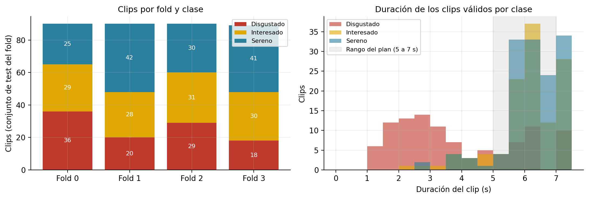
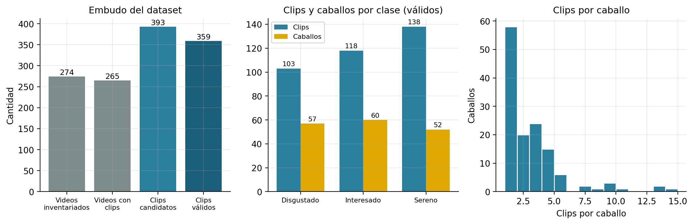

# 3. Dataset

Fuente de todas las cifras: `datos_equinos/resultados/inventario_videos.csv`, `inventario_clips.csv`, `dataset_rechazos_v2.json`, `dataset_frames_alineados_v2.csv`, `particion_clips.json`, procesados por `scripts/a01_dataset.py` y `scripts/a02_duplicados.py` (salidas en `datos/dataset.json`, `datos/duplicados.json`).

## 3.1 Del video al clip válido

| Etapa | Cantidad | Detalle |
|---|---|---|
| Videos inventariados | 274 | 138 identificadores de caballo |
| Videos que generaron al menos un clip | 265 | 9 sin clips (demasiado cortos) |
| Clips candidatos | 393 | 136 caballos |
| Clips descartados | 34 | VENTANA_CORTA: 31, SIN_KEYPOINTS: 3 |
| **Clips válidos (dataset de modelado)** | **359** | 244 videos, **133 caballos**, 5744 frames (16 por clip) |
| % clips válidos / % videos aprovechados / % caballos | 91,3 % / 89,1 % / 96,4 % | sobre candidatos / inventariados / identificados |

| Clase | Videos inventariados | Clips candidatos | Descartados | Clips válidos | % válidos | Videos con clips válidos | Caballos |
|---|---|---|---|---|---|---|---|
| Disgustado | 110 | 113 | 10 | 103 | 91,2 % | 91 | 57 |
| Interesado | 71 | 120 | 2 | 118 | 98,3 % | 69 | 60 |
| Sereno | 93 | 160 | 22 | 138 | 86,2 % | 84 | 52 |
| **Total** | 274 | 393 | 34 | 359 | 91,3 % | 244 | 133 |

- **Unidad de análisis**: el *clip* (ventana de 5–7 s de un video, ya recodificada) del que se eligen 16 frames. La **etiqueta se asigna al video entero** y se hereda a sus clips (`docs/protocolo_de_etiquetado.md` §1); el recorte de tramos por la etiquetadora sostiene el supuesto de que la expresión dura toda la toma.
- **Inválidos / descartados**: 34 de 393 clips (8,7 %): 31 por `VENTANA_CORTA` (ninguna ventana con 16 mediciones válidas del par ojo–hocico) y 3 por `SIN_KEYPOINTS`. Además, 9 de 274 videos no generaron ningún clip (duración menor al piso de 1 s). **El descarte no es parejo entre clases**: `Sereno` pierde 13,8 % de sus clips, `Disgustado` 8,8 % e `Interesado` 1,7 %. Quedan fuera los clips donde DeepLabCut no mide bien la cara; la población de «caras bien medibles» es la que se evalúa (sesgo de selección documentado, no cuantificable aquí).
- **Frames**: 5 744 = 359 × 16; los 5 744 con `alineado = True` y `origen_alineacion = keypoints` (ninguno interpolado ni anotado a mano en el conjunto vigente).

## 3.2 Caballos

| Medida | Valor |
|---|---|
| Caballos con clips válidos | 133 |
| Clips por caballo (media / mediana / mín–máx) | 2,70 / 2 / 1–14 |
| Caballos con un único clip | 58 (43,6 %) |
| Caballos con 5 o más clips | 16 |
| 10 caballos con más clips acumulan | 27,6 % de los clips |
| Caballos en una sola clase | 104 |
| Caballos en dos clases | 22 |
| Caballos en las tres clases | 7 |
| Caballos en más de una clase | 29 (21,8 %), con 145 clips (40,4 %) |

**Qué significa:** el tamaño muestral efectivo está más cerca de los 133 caballos que de los 359 clips (§13). 58 caballos (43,6 %) aportan un único clip, y 10 caballos reúnen el 27,6 % de los clips (el máximo es 14 clips del caballo `037`).

## 3.3 Distribución por fold (test de cada fold)

| Fold (test) | Caballos | Clips | Disgustado | Interesado | Sereno | Caballos D / I / S |
|---|---|---|---|---|---|---|
| 0 | 33 | 90 | 36 | 29 | 25 | 13 / 15 / 16 |
| 1 | 33 | 90 | 20 | 28 | 42 | 16 / 12 / 14 |
| 2 | 34 | 90 | 29 | 31 | 30 | 15 / 19 / 11 |
| 3 | 33 | 89 | 18 | 30 | 41 | 13 / 14 / 11 |

Cada caballo está en exactamente un fold (verificado, §6). La composición dentro de cada fold —train interno, validación interna y test— está en el capítulo 5.

## 3.4 Características técnicas que difieren entre clases

| Clase | Duración P25 (s) | Mediana (s) | P75 (s) | % en 5–7 s | Resoluciones (clips) |
|---|---|---|---|---|---|
| Disgustado | 2,3 | 3,2 | 5,7 | 27 % | 1080x1920 (93), 2560x1440 (8), 640x480 (2) |
| Interesado | 6,0 | 6,0 | 7,0 | 76 % | 1080x1920 (91), 640x480 (26), 720x1280 (1) |
| Sereno | 6,0 | 6,0 | 7,0 | 88 % | 1080x1920 (138) |

*Figura 3.1. Clips por fold y clase (izquierda) y duración de los clips por clase (derecha). La banda gris es el rango de 5 a 7 s que fija el plan.*

- **El 33,4 % de los clips válidos (120 de 359) dura menos de 5 s** y 85 menos de 4,5 s. La duración mediana de `Disgustado` es 3,2 s (P25: 2,3 s); la de `Sereno` e `Interesado`, 6,0 s. La clase minoritaria es, sistemáticamente, la de tomas más cortas (son interacciones breves; `docs/protocolo_de_etiquetado.md` §3).
- Las resoluciones atípicas son de una sola clase: 640×480 sólo en `Interesado` (26 clips) y `Disgustado` (2); 2560×1440 sólo en `Disgustado` (8). `Sereno` es 100 % 1080×1920.
- Consecuencia medida en el capítulo 10: **la duración sola predice la clase con F1 macro 0,544 y los metadatos de filmación con 0,618**, sin mirar la cara.

## 3.5 Duplicados

| Prueba | Resultado |
|---|---|
| SHA-256 de los 274 archivos de video fuente | **0 pares idénticos** (todos los archivos existen y se leyeron) |
| MD5 de los 5 744 recortes alineados | **0 grupos** de recortes idénticos entre clips distintos |
| Hash perceptual (dHash 256 bits) de los 5 744 recortes | **0 grupos** de recortes visualmente idénticos entre clips distintos; ninguno cruza folds ni clases |
| Frames repetidos dentro de un mismo clip | 0 |
| Solapamiento temporal entre clips de un mismo video | 0 (clips contiguos, sin solape) |
| Videos con clips en más de un fold | 0 |
| Firma perceptual de video (8 frames, Hamming ≤ 6 de 64 bits) | 10 pares de videos con escena parecida, **todos `Disgustado`**; 6 de ellos entre identificadores de caballo distintos (`709`, `710`, `711`, `712`, `705`, `707`). Tienen distinta duración y contenido: son **tomas de la misma sesión y lugar (27/08/2026), no copias** |
| Posible mismo caballo con dos identificadores (`123` y `169`) | **No pudo verificarse con los archivos disponibles.** Ambos son `Interesado`, filmados con 34 s de diferencia en el mismo box (04/10/2025), están en folds 3 y 0, y el cribado por características los ubica 2.º de todos los pares entre folds (`datos/identidades.json`). Afecta a 5 clips (1,4 %) |

No se observan evidencias de duplicación de material. El riesgo remanente es **de sesión y de lugar**, no de copia (§6.4).

## 3.6 Consistencia de nombres y etiquetas

- El `id_caballo` sale del prefijo numérico del nombre de archivo (`obtener_id_caballo`); coincide en los 393 clips con el prefijo del clip y del video de origen; 3 dígitos en todos los casos.
- Las tres clases se escriben igual en todos los CSV/JSON; 0 videos con la misma clase asignada de dos formas; 0 nombres que colapsen al normalizarlos.
- Hay 7 nombres con espacios y 6 con «Copia de…» (resto de ediciones manuales); 246 `.mp4`, 15 `.mkv`, 13 `.avi`. **La carpeta (clase) condiciona el contenedor**: `Sereno` es 100 % `.mp4`/H.264, mientras que `.mkv` aparece sólo en `Disgustado` y `.avi` casi sólo en `Interesado` (§10.3).
- 40 videos viven en subcarpetas de trabajo (`Seleccionar cabeza?` y `Se tapa una parte de la cara`); se suman a su clase por declaración explícita en `equinos/catalogo.py`, y `Separar cabeza?` ya no existe (verificado en `docs/protocolo_de_etiquetado.md` §4).

*Figura 3.2. Embudo del dataset, clips y caballos por clase, y distribución de clips por caballo.*
