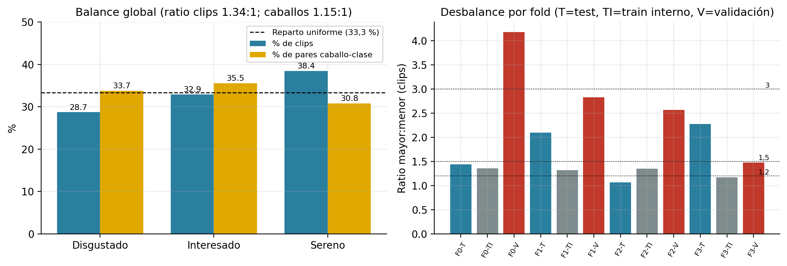

# 4. Balance de clases

## 4.1 Criterio (declarado antes de calcular)

Se usa el *imbalance ratio* (IR = n de la clase mayor / n de la clase menor), la medida habitual en la literatura de datos desbalanceados (p. ej., Fernández et al., 2018, *Learning from Imbalanced Data Sets*, Springer). **No existe un umbral normativo universal**; los cortes siguientes son una convención de esta auditoría, fijada en `scripts/a03_balance_folds_leakage.py` antes de calcular y sometida a un análisis de sensibilidad:

| IR | Clasificación |
|---|---|
| ≤ 1,2 | BALANCEADO |
| > 1,2 y ≤ 1,5 | RAZONABLEMENTE BALANCEADO |
| > 1,5 y ≤ 3 | MODERADAMENTE DESBALANCEADO |
| > 3 | FUERTEMENTE DESBALANCEADO |

Se aplica por separado a clips y a caballos, porque la unidad que importa estadísticamente es el caballo (capítulo 13).

## 4.2 Resultado global

| Clase | Clips | % clips | Caballos | % caballos |
|---|---|---|---|---|
| Disgustado | 103 | 28,7 % | 57 | 42,9 % |
| Interesado | 118 | 32,9 % | 60 | 45,1 % |
| Sereno | 138 | 38,4 % | 52 | 39,1 % |
| **Total** | 359 | 100 % | 133 (distintos) | — |

*Los % de caballos se calculan sobre los 133 caballos distintos y suman más de 100 % porque 29 caballos tienen clips en más de una clase.*

| Unidad | Ratio mayor : menor | Clasificación (criterio declarado) |
|---|---|---|
| Clips | 1,34 : 1 | RAZONABLEMENTE BALANCEADO |
| Caballos | 1,15 : 1 | BALANCEADO |

**Sensibilidad al criterio**

| Cortes del ratio (balanceado / razonable / moderado) | Clips | Caballos |
|---|---|---|
| 1,20 / 1,50 / 3,00 | RAZONABLEMENTE BALANCEADO | BALANCEADO |
| 1,10 / 1,30 / 2,00 | MODERADAMENTE DESBALANCEADO | RAZONABLEMENTE BALANCEADO |
| 1,25 / 2,00 / 4,00 | RAZONABLEMENTE BALANCEADO | BALANCEADO |

- Con el criterio declarado: **RAZONABLEMENTE BALANCEADO en clips** (IR 1,34) y **BALANCEADO en caballos** (IR 1,15). La entropía normalizada del reparto de clips es 0,993 (1 = reparto uniforme).
- **Evidencia que matiza el veredicto.** (a) Con cortes más estrictos (1,1 / 1,3 / 2), los clips pasan a MODERADAMENTE DESBALANCEADO: la categoría depende del criterio, aunque la diferencia real (38,4 % frente a 28,7 %) es pequeña. (b) `Sereno` tiene *menos* caballos (52) pero *más* clips (138) que las otras clases: 2,65 clips por caballo contra 1,81 de `Disgustado`; el desbalance por caballos es menor que el de clips, lo que favorece al modelo (más variedad de individuos en la clase minoritaria de lo que sugieren los clips).
- Efecto práctico: la accuracy mayoritaria es 0,384, por lo que la métrica correcta es F1 macro; los pesos de clase de la pérdida usan la raíz cuadrada de la frecuencia inversa (`estrategia_pesos = "raiz"`).

## 4.3 Balance dentro de los folds

El balance **global** no se transmite a cada subconjunto. Las particiones se arman por caballo y **no se estratifican por clase** (`particion.construir`). El detalle de cada subconjunto está en el capítulo 5; en resumen, **7 de 12 subconjuntos** (test, train interno y validación interna de 4 folds) son BALANCEADOS o RAZONABLEMENTE BALANCEADOS y **5 son MODERADA o FUERTEMENTE desbalanceados**: los tests de los folds 1 y 3 (IR 2,10 y 2,28, con 20–22 % de `Disgustado`) y las validaciones internas de los folds 0 (IR 4,18: 65,7 % `Sereno`), 1 (2,83) y 2 (2,57).

*Figura 4.1. Balance global (izquierda) y ratio mayor:menor por fold y conjunto (derecha), con los cortes del criterio.*

**Lectura.** El balance global es aceptable; la variabilidad de composición entre folds (el recall y el F1 de `Disgustado` por fold se mueven en consecuencia) contribuye a la dispersión del F1 macro entre folds (0,677–0,795) y justifica informar la media ± desvío en lugar de un único número.
