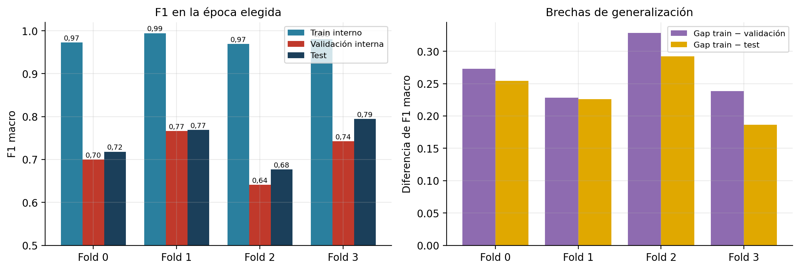

# 5. Folds, entrenamiento interno, validación interna y test

## 5.1 Cómo se construyen

1. **Folds externos (test).** `particion.construir`: los 133 caballos se ordenan por cantidad de clips (descendente, desempate por id) y se asignan, uno a uno, al fold con menos clips acumulados. Es una *réplica del reparto voraz de `GroupKFold`*, **sin semilla y sin estratificar por clase**. **No coincide con `sklearn.model_selection.GroupKFold`**: comparadas, las dos particiones asignan el mismo fold al 0,382 de los clips (los tamaños de fold sí son los mismos: 90/90/90/89). El docstring del módulo habla de «réplica determinista de `GroupKFold`»: es cierto en el algoritmo general, pero no en el reparto exacto. No afecta la validez, sí la afirmación de equivalencia.
2. **Corte interno.** Dentro de cada fold, `dividir_por_ejemplar(train_val, 0,25)` separa **train interno** y **validación interna** por caballo, también de forma determinista.
3. El test se usa **una sola vez**, tras cargar el mejor checkpoint (§7).

## 5.2 Composición de cada subconjunto

| Fold | Conjunto | Caballos | Clips | Disgustado | Interesado | Sereno | Ratio | Categoría |
|---|---|---|---|---|---|---|---|---|
| 0 | Test | 33 | 90 | 36 (40,0 %) | 29 (32,2 %) | 25 (27,8 %) | 1,44 : 1 | Razonablemente balanceado |
| 0 | Train interno | 93 | 199 | 56 (28,1 %) | 76 (38,2 %) | 67 (33,7 %) | 1,36 : 1 | Razonablemente balanceado |
| 0 | Validación interna | 7 | 70 | 11 (15,7 %) | 13 (18,6 %) | 46 (65,7 %) | 4,18 : 1 | Fuertemente desbalanceado |
| 1 | Test | 33 | 90 | 20 (22,2 %) | 28 (31,1 %) | 42 (46,7 %) | 2,1 : 1 | Moderadamente desbalanceado |
| 1 | Train interno | 93 | 199 | 59 (29,6 %) | 78 (39,2 %) | 62 (31,2 %) | 1,32 : 1 | Razonablemente balanceado |
| 1 | Validación interna | 7 | 70 | 24 (34,3 %) | 12 (17,1 %) | 34 (48,6 %) | 2,83 : 1 | Moderadamente desbalanceado |
| 2 | Test | 34 | 90 | 29 (32,2 %) | 31 (34,4 %) | 30 (33,3 %) | 1,07 : 1 | Balanceado |
| 2 | Train interno | 92 | 199 | 54 (27,1 %) | 73 (36,7 %) | 72 (36,2 %) | 1,35 : 1 | Razonablemente balanceado |
| 2 | Validación interna | 7 | 70 | 20 (28,6 %) | 14 (20,0 %) | 36 (51,4 %) | 2,57 : 1 | Moderadamente desbalanceado |
| 3 | Test | 33 | 89 | 18 (20,2 %) | 30 (33,7 %) | 41 (46,1 %) | 2,28 : 1 | Moderadamente desbalanceado |
| 3 | Train interno | 93 | 197 | 59 (29,9 %) | 69 (35,0 %) | 69 (35,0 %) | 1,17 : 1 | Balanceado |
| 3 | Validación interna | 7 | 73 | 26 (35,6 %) | 19 (26,0 %) | 28 (38,4 %) | 1,47 : 1 | Razonablemente balanceado |

Proporción de cada subconjunto sobre los 359 clips: test ≈ 25 % (89–90 clips), validación interna ≈ 19–20 % (70–73 clips), train interno ≈ 55 % (197–199 clips); en caballos, ≈ 33 de test, 7 de validación y ≈ 93 de train interno por fold.

## 5.3 Hallazgo: la validación interna son los caballos con más clips

`dividir_por_ejemplar` ordena los caballos del `train_val` por cantidad de clips y **asigna a validación los primeros hasta cubrir el 25 % de los clips**. El resultado (`datos/validacion_interna_composicion.json`):

- La validación interna son **los 7 caballos con más clips** de cada fold, con **10 clips por caballo en promedio** (7 a 14), frente a 2,1 clips por caballo en el train interno y 2,7 en el conjunto completo.
- Por eso el train interno **pierde justamente a los caballos más representados** y la validación pesa por igual a esos 7 individuos, mientras que el test sí es una muestra de todos los caballos del fold (≈ 33).
- Cinco o seis de los 7 caballos de validación de cada fold tienen clips en más de una clase.
- La validación interna de cada fold queda **desbalanceada** (IR de 1,47 a 4,18; 65,7 % `Sereno` en el fold 0).

Es la base sobre la que se elige la época y los hiperparámetros (dropout 0,3, pesos `raiz`). **Es una debilidad real del diseño**, no una fuga: el test no interviene (§7). Sus efectos medibles son la elección de época ruidosa (20 a 40 entre folds con la misma semilla; 13 a 50 entre semillas) y una métrica de validación que no es un buen proxy: el test fue **igual o mayor** que la validación en los 4 folds (diferencia media +0,027).

*Figura 5.1. F1 macro de train interno, validación interna y test en la época elegida (izquierda) y brechas (derecha).*
