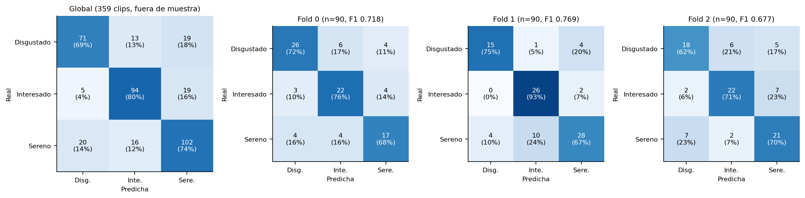

# 9. Rendimiento: métricas, estabilidad entre folds, confusiones y cifras históricas

## 9.1 El valor vigente (único)

**Archivo que constituye la evaluación vigente: `datos_equinos/resultados/objetivo3_evaluacion_v2.json`** (generado por `scripts/evaluar_v2.py`; re-ejecutado el 25/09/2026 con resultado idéntico). Es también el archivo del que lee la interfaz (`clasificacion.ARCHIVO_EVALUACION`).

| Métrica (fuera de muestra, 359 clips, 133 caballos) | Valor |
|---|---|
| **F1 macro (media de los 4 folds ± DE muestral)** | **0,740 ± 0,052** |
| IC 95 % del F1 macro (bootstrap por caballo, 2 000 réplicas, F1 agrupado) | [0,677; 0,797] |
| F1 macro agrupado (las 359 predicciones juntas) | 0,742 |
| Accuracy | 0,744 (267/359) |
| Balanced accuracy | 0,742 |
| F1 ponderado agrupado | 0,743 |

**Verificación de la métrica.** `clasificacion.f1_macro` es una implementación propia de la media **no ponderada** del F1 por clase (cada clase pesa igual). Se comprobó contra `sklearn.metrics.f1_score(average="macro", labels=CLASES)` en los 4 folds con tolerancia 10⁻¹²: coinciden. Hay **dos formas de «F1 macro»** que no deben mezclarse: la **media de los F1 macro por fold (0,740)**, que es la que informa el proyecto, y el F1 macro de las predicciones agrupadas (0,742). La desviación estándar usa *n − 1* (0,0524); con *n* sería 0,0454. Con sólo 4 folds, es una estimación gruesa de la variabilidad.

## 9.2 Estabilidad entre folds

| Fold | n | F1 macro | Accuracy | Balanced acc. | F1 Disgustado | F1 Interesado | F1 Sereno |
|---|---|---|---|---|---|---|---|
| 0 | 90 | 0,718 | 0,722 | 0,720 | 0,754 | 0,721 | 0,680 |
| 1 | 90 | 0,769 | 0,767 | 0,782 | 0,769 | 0,800 | 0,737 |
| 2 | 90 | 0,677 | 0,678 | 0,677 | 0,643 | 0,721 | 0,667 |
| 3 | 89 | 0,795 | 0,809 | 0,782 | 0,686 | 0,889 | 0,809 |
| **Media ± DE** | 359 | **0,740 ± 0,052** | 0,744 ± 0,057 |  |  |  |  |

| Medida | Valor |
|---|---|
| F1 macro media entre folds | 0,740 |
| Desvío estándar (n−1) | 0,052 |
| Desvío estándar poblacional (n) | 0,045 |
| Mínimo (fold 2) | 0,677 |
| Máximo (fold 3) | 0,795 |
| Rango | 0,118 |
| Coeficiente de variación | 7,1 % |

El fold 2 es el peor (0,677) y el fold 3 el mejor (0,795): una diferencia de 0,118, dentro de lo que cabe esperar con ≈ 33 caballos por fold y composiciones de clase distintas (capítulo 4). **No hay folds colapsados**, pero la dispersión es 2,6 veces la del baseline lineal (DE 0,020).

## 9.3 Precision, recall y F1 por clase

| Clase | Precision | Recall | F1 | Soporte |
|---|---|---|---|---|
| Disgustado | 0,740 | 0,689 | 0,714 | 103 |
| Interesado | 0,764 | 0,797 | 0,780 | 118 |
| Sereno | 0,729 | 0,739 | 0,734 | 138 |
| **Macro** | 0,744 | 0,742 | 0,742 | 359 |

*Métricas calculadas sobre las 359 predicciones fuera de muestra agrupadas; la media de F1 por fold (0,740) difiere de la agrupada (0,742) por el promedio.*

| Fold | Clase | Precision | Recall | F1 | Soporte |
|---|---|---|---|---|---|
| 0 | Disgustado | 0,788 | 0,722 | 0,754 | 36 |
| 0 | Interesado | 0,688 | 0,759 | 0,721 | 29 |
| 0 | Sereno | 0,680 | 0,680 | 0,680 | 25 |
| 1 | Disgustado | 0,789 | 0,750 | 0,769 | 20 |
| 1 | Interesado | 0,703 | 0,929 | 0,800 | 28 |
| 1 | Sereno | 0,824 | 0,667 | 0,737 | 42 |
| 2 | Disgustado | 0,667 | 0,621 | 0,643 | 29 |
| 2 | Interesado | 0,733 | 0,710 | 0,721 | 31 |
| 2 | Sereno | 0,636 | 0,700 | 0,667 | 30 |
| 3 | Disgustado | 0,706 | 0,667 | 0,686 | 18 |
| 3 | Interesado | 1,000 | 0,800 | 0,889 | 30 |
| 3 | Sereno | 0,750 | 0,878 | 0,809 | 41 |

## 9.4 Matrices de confusión

**Global (agregada sobre los 4 folds; filas = clase real):**

|  | Pred. Disgustado | Pred. Interesado | Pred. Sereno | Total |
|---|---|---|---|---|
| **Real Disgustado** | 71 | 13 | 19 | 103 |
| **Real Interesado** | 5 | 94 | 19 | 118 |
| **Real Sereno** | 20 | 16 | 102 | 138 |
| **Total predicho** | 96 | 123 | 140 | 359 |

*Figura 9.1. Matriz de confusión global (izquierda) y de los folds 0 a 2; la del fold 3 está en la tabla de abajo. Porcentajes por fila.*

**Por fold:**

**Fold 0** (n = 90, F1 macro 0,718)

|  | Pred. Disgustado | Pred. Interesado | Pred. Sereno | Total |
|---|---|---|---|---|
| **Real Disgustado** | 26 | 6 | 4 | 36 |
| **Real Interesado** | 3 | 22 | 4 | 29 |
| **Real Sereno** | 4 | 4 | 17 | 25 |
| **Total predicho** | 33 | 32 | 25 | 90 |

**Fold 1** (n = 90, F1 macro 0,769)

|  | Pred. Disgustado | Pred. Interesado | Pred. Sereno | Total |
|---|---|---|---|---|
| **Real Disgustado** | 15 | 1 | 4 | 20 |
| **Real Interesado** | 0 | 26 | 2 | 28 |
| **Real Sereno** | 4 | 10 | 28 | 42 |
| **Total predicho** | 19 | 37 | 34 | 90 |

**Fold 2** (n = 90, F1 macro 0,677)

|  | Pred. Disgustado | Pred. Interesado | Pred. Sereno | Total |
|---|---|---|---|---|
| **Real Disgustado** | 18 | 6 | 5 | 29 |
| **Real Interesado** | 2 | 22 | 7 | 31 |
| **Real Sereno** | 7 | 2 | 21 | 30 |
| **Total predicho** | 27 | 30 | 33 | 90 |

**Fold 3** (n = 89, F1 macro 0,795)

|  | Pred. Disgustado | Pred. Interesado | Pred. Sereno | Total |
|---|---|---|---|---|
| **Real Disgustado** | 12 | 0 | 6 | 18 |
| **Real Interesado** | 0 | 24 | 6 | 30 |
| **Real Sereno** | 5 | 0 | 36 | 41 |
| **Total predicho** | 17 | 24 | 48 | 89 |

- Los errores se reparten sin una dirección dominante clara: `Sereno → Disgustado` (20), `Disgustado → Sereno` (19), `Interesado → Sereno` (19) y `Sereno → Interesado` (16). La confusión entre extremos conceptuales (`Interesado` ↔ `Disgustado`: 13 + 5) es la menor.
- **Los errores se concentran en pocos caballos**: 55 de 133 caballos tienen al menos un error y los 10 peores acumulan el 40,2 % de los 92 errores (`906`: 6/13; `013`: 5/5; `037`: 5/14; `053`: 4/4; `044`, `251`, `916`: 3/3). 9 caballos con ≥ 2 clips fallan en el 100 % de sus clips. Es un hallazgo del conjunto de datos (candidatos a revisión de etiqueta o de identidad), no sólo del modelo.

## 9.5 Cifras históricas y su estatus

Ninguna de estas cifras es comparable con 0,740: cambian el conjunto de clips y, en las primeras, el protocolo de selección de época.

| Cifra | Modelo | Dataset | Fecha | Commit / origen | Artefacto | ¿Vigente? |
|---|---|---|---|---|---|---|
| 0,626 ± 0,065 | Un frame + voto (LogReg) | 141 clips / 73 caballos | 2026-08-28 | 6f50a59 (línea de base) / 425c592 (evaluación final) | no (objetivo3_evaluacion.json lo sobrescribió; se cita en project.md) | No |
| 0,704 ± 0,044 | Cabeza «promedio» (MLP sobre media de frames) | 153 clips / 83 caballos | 2026-09-15 | archivo objetivo3_evaluacion.json (mtime 15/09) | sí: objetivo3_evaluacion.json | No |
| 0,754 | MIL multimodal (otra corrida) | 257 clips / 113 caballos (según docs) | 2026-09-15 | 6b66044 (primera aparición, escrito a mano en clasificacion.py); retirado en 5e41c63 (18/09) | NO: sin artefacto que lo respalde | No (no citar) |
| 0,618 | MIL con validación interna | 153 clips / 83 caballos | 2026-09-18 | docs/informe_mejora_pipeline_mil.md §6 | no (cifra en el informe) | No |
| 0,740 ± 0,052 | MIL multimodal (MILFusionModel) | 359 clips / 133 caballos | 2026-09-18 (re-ejecutado 25/09) | 4e51800 (protocolo), cf23ded (selección de frames); archivo objetivo3_evaluacion_v2.json | sí: objetivo3_evaluacion_v2.json | SÍ (única cifra vigente) |
| 0,741 ± 0,020 | Estática: media de 16 frames + LogReg | 359 / 133 | 2026-09-25 | e75f13a | sí: objetivo3_lineas_de_base.json | Línea de base vigente |
| 0,618 ± 0,034 | Solo metadatos de filmación (LogReg) | 359 / 133 | 2026-09-25 | e75f13a | sí: objetivo3_lineas_de_base.json | Línea de base vigente |
| 0,686 | MIL visual puro (sin geometría) | 359 / 133 | 2026-09-18 | docs/informe_mejora_pipeline_mil.md §7 | no (cifra en el informe) | No (variante) |
| 0,747 ± 0,057 | MIL con fine-tuning del backbone | 359 / 133 | 2026-09-22 | rama feat/finetuning-visual (c6d6f80, 544d323) | sí: objetivo3_finetuning_evaluacion.json | No (no adoptado) |
| 0,698 ± 0,103 | MIL con canal geométrico enriquecido | 359 / 133 | 2026-09-22 | rama feat/enriquecer-canal-geometrico | sí | No (no adoptado) |
| 0,755 ± 0,022 | MIL reentrenado sobre 100 % del train_val | 359 / 133 | 2026-09-23 | rama feat/validacion-cruzada-anidada-NestedCV (23d4b25) | sí | No (no adoptado) |
| 0,784 ± 0,036 | MIL con CV anidada (época promedio) | 359 / 133 | 2026-09-23 | rama feat/validacion-cruzada-anidada-NestedCV | sí | No (no adoptado; optimista) |

**Regla de uso:** citar sólo `objetivo3_evaluacion_v2.json` como resultado del modelo vigente, siempre acompañado de `objetivo3_lineas_de_base.json`. La cifra **0,754** no tiene artefacto que la respalde (apareció escrita a mano en `clasificacion.py` el 15/09, en el commit `6b66044`, y se retiró el 18/09) y no debe citarse.
