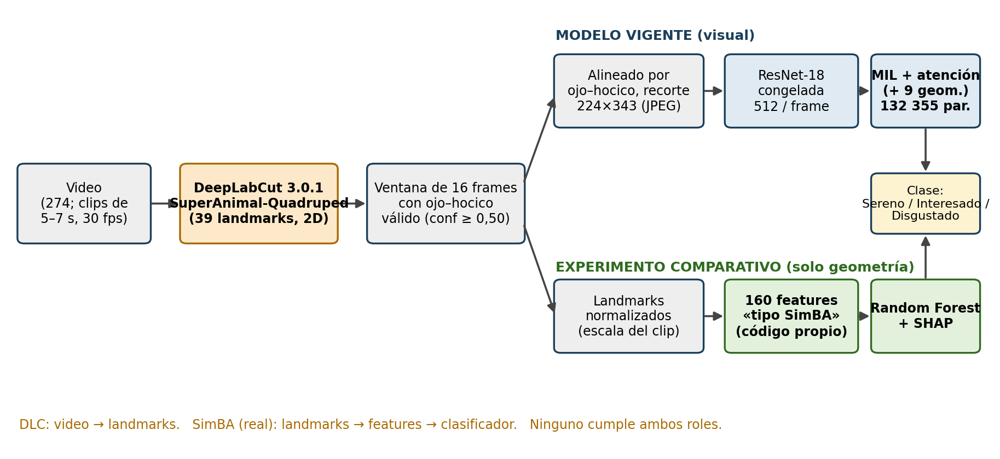
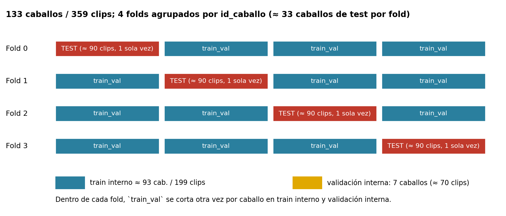
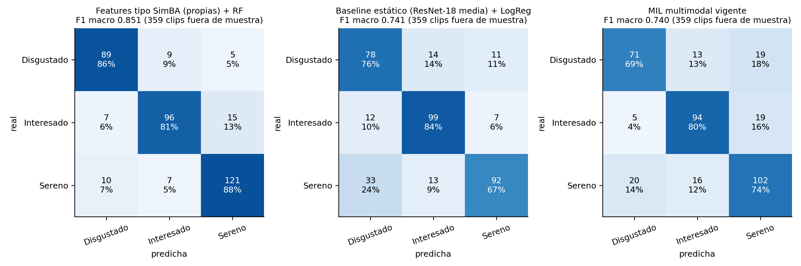
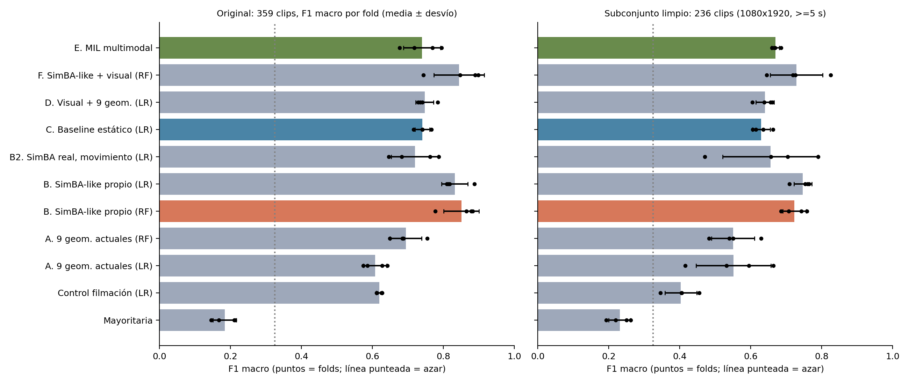
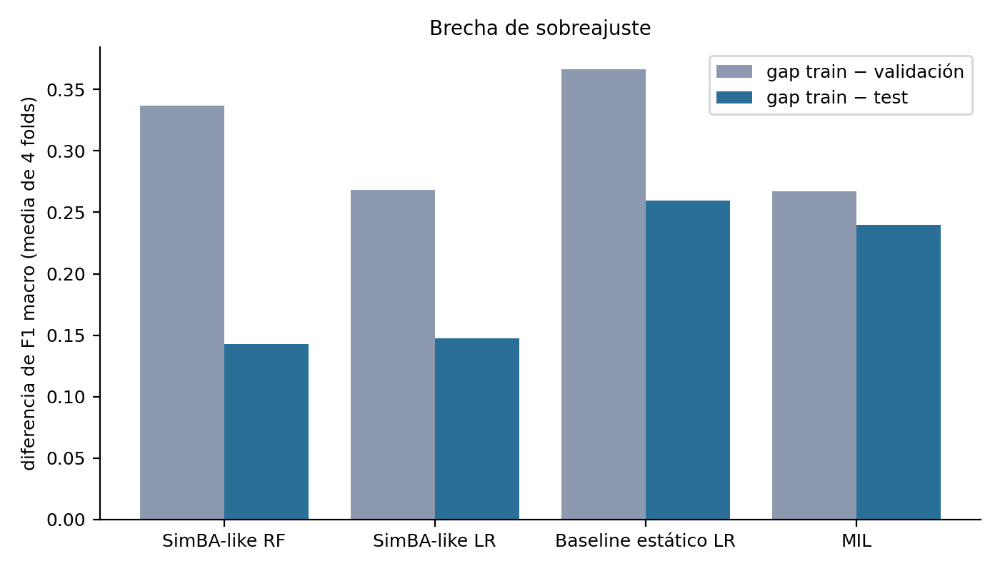
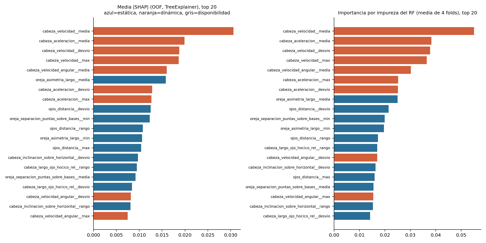
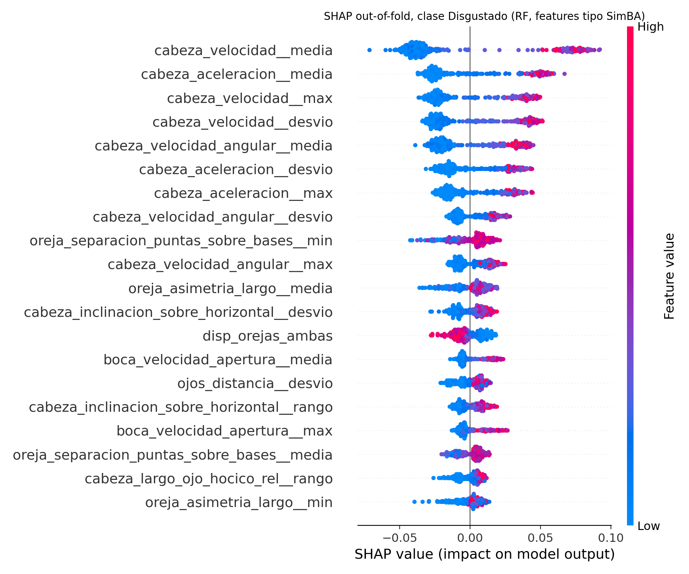
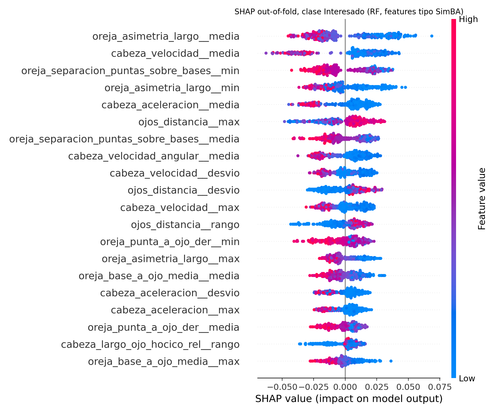
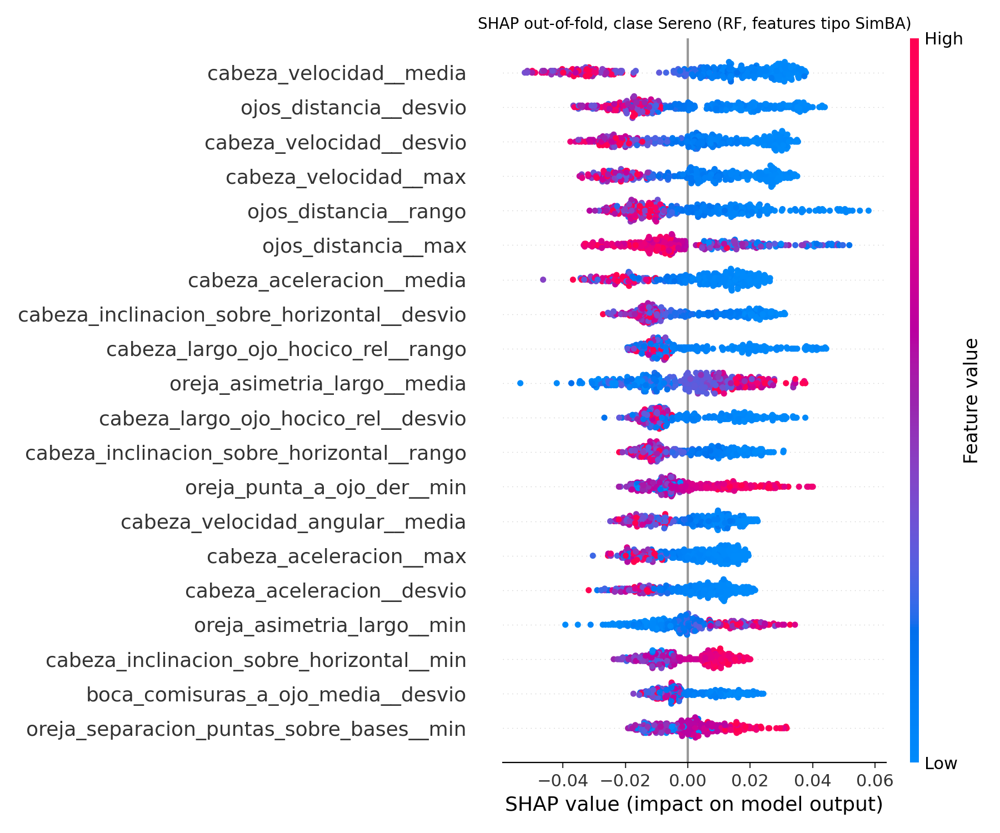

# 17. Experimento comparativo con features de pose «tipo SimBA»

Fuentes: `experimentos/simba/` (README, `resultados/*.json|csv|png`) y la **revisión adversarial** `experimentos/simba/verificacion/` (README y `verificacion.json`). **Donde la verificación y el resumen original difieren, vale la verificación.** El experimento es adicional y aislado: no modifica `equinos/` ni el MIL vigente, y no vuelve a ejecutar DeepLabCut.

> **Nombres.** El conjunto principal son **«features tipo SimBA calculadas con código propio»** (`features_simba.py`); **no es SimBA**. SimBA real (`simba-uw-tf-dev 5.6.1`) se instaló y ejecutó sobre los 359 clips, pero para un solo animal sólo entrega *movimiento* por landmark (conjunto B2). En todo el documento «SimBA-RF» designa al Random Forest sobre las features propias.

## 17.1 Roles: DeepLabCut y SimBA

*Figura 17.1. Pipeline video → DeepLabCut → features → clasificador. Arriba, el modelo vigente; abajo, el experimento comparativo con la misma pose y los mismos 16 frames.*

| Herramienta | Rol | Entrada → salida |
|---|---|---|
| **DeepLabCut** (SuperAnimal-Quadruped) | Estimador de pose | video → 39 landmarks 2D por frame, con *likelihood* |
| **SimBA** (real) | Features y clasificador de conducta | landmarks → features → clasificador. Para un animal, el extractor sólo calcula movimiento por *bodypart*, su resumen y ventanas móviles (59 columnas por frame; 174 por clip tras agregar) |
| **Código propio del experimento** | Reemplaza el rol «features» | landmarks → 160 features faciales y cefálicas → Random Forest |

Ninguna de las dos herramientas cumple ambos roles; DeepLabCut sigue siendo imprescindible en cualquiera de los enfoques.

## 17.2 Compatibilidad e importación DLC → SimBA

(`resultados/compatibilidad_dlc_simba.json`) La pose del proyecto está en **formato largo** (`clip, orden, bodypart, x, y, confianza`), en **píxeles del cuadro original** (hasta 1981 × 1942 px), **sin normalizar ni alinear**; resoluciones de origen de 640×480 a 2560×1440. **La importación directa a SimBA no es posible**: SimBA espera formato ancho (`<bp>_x, <bp>_y, <bp>_p`) o el CSV/H5 multiíndice de DLC, un proyecto con `project_config.ini`, definición de los 39 *body-parts*, `video_info.csv` (fps, resolución, px/mm) y series de frames **consecutivos** a fps constante, mientras aquí son 16 frames separados 0,1–0,5 s (mediana 0,33 s). Se necesitó una **conversión** (`simba_real_intento.py` escribe los 359 clips en formato ancho y crea el proyecto); los px/mm no se calibraron (1,0), de modo que las distancias de SimBA quedan en píxeles dependientes de la resolución. Para importar el paquete hizo falta un *stub* vacío de `tkinter` (no instalado; sólo afecta a la interfaz gráfica).

## 17.3 Inventario anatómico: qué se puede y qué no se puede observar

Con 39 landmarks 2D (la disponibilidad se mide sobre los 5 744 frames seleccionados, **sesgados** hacia ojo y hocico por la forma de seleccionar la ventana):

| Landmark | % de frames con confianza ≥ 0,50 | % de clips con algún frame ≥ 0,50 |
|---|---|---|
| nose | 100,0 % | 100,0 % |
| upper_jaw | 87,6 % | 99,4 % |
| lower_jaw | 79,1 % | 99,7 % |
| mouth_end_right | 44,8 % | 68,8 % |
| mouth_end_left | 41,6 % | 68,8 % |
| right_eye | 96,6 % | 100,0 % |
| left_eye | 94,1 % | 100,0 % |
| right_earbase | 64,7 % | 94,7 % |
| right_earend | 58,3 % | 90,8 % |
| left_earbase | 67,1 % | 95,0 % |
| left_earend | 59,3 % | 94,2 % |
| neck_base | 24,9 % | 66,9 % |
| neck_end | 36,2 % | 81,3 % |

| Aspecto facial | Clasificación | Motivo |
|---|---|---|
| angulo de orejas respecto del eje de la cabeza | aproximada | earbase/earend de cada oreja; proyección 2D, depende del punto de vista |
| largo/posición de orejas, asimetría L-R, separación entre puntas | aproximada | 2D con escorzo; 'izquierda/derecha' es del animal, no de la imagen |
| apertura del ojo | imposible | un solo keypoint por ojo; no hay párpados superior/inferior |
| parpadeo | imposible | no hay apertura de ojo; además se muestrean 16 frames separados 0,2-0,5 s (un parpadeo dura ~0,1-0,4 s) |
| distancia interocular / ojo-hocico | directamente observable (en 2D) | ambos ojos y nariz |
| labios (tensión, comisuras) | aproximada | solo comisuras (mouth_end_*) y mandíbulas (upper/lower_jaw), no labios; comisuras visibles en poco frames |
| apertura de mandíbula/boca | aproximada | upper_jaw-lower_jaw |
| fosas nasales, tensión muscular, surcos faciales | imposible | no existen landmarks para esas estructuras |
| orientación/inclinación de cabeza en el plano de la imagen | directamente observable | eje ojo(s)->hocico |
| pitch/yaw/roll 3D de la cabeza | imposible (solo proxy) | pose 2D monocular; el cociente largo ojo-hocico / mediana del clip es un proxy de escorzo, no de ángulo |
| ángulo cabeza-cuello | aproximada | neck_base/neck_end con confianza >=0,50 en 25-36 % de los frames; semántica exacta de neck_* no verificada |
| velocidades (cabeza, orejas, mandíbula) | aproximada | diferencias entre los 16 frames del clip (separados 0,2-0,5 s); la velocidad de cabeza incluye movimiento de cámara y de cuerpo (no hay marco fijo) |
| aceleraciones | aproximada (más ruidosa) | segunda diferencia sobre muestreo grueso y jitter de keypoints |
| simetría L-R | aproximada | depende del punto de vista (vistas de perfil ocultan un lado) |
| antler_base/antler_end | no usadas | puntos del esquema SuperAnimal-Quadruped pensados para cuernas; su correspondencia anatómica en el caballo No pudo verificarse con los archivos dispon |

**Conclusiones del inventario:** no existe **apertura del ojo ni parpadeo** (hay un único landmark por ojo; además el muestreo de 0,1–0,5 s no resuelve un parpadeo de 0,1–0,4 s); tampoco fosas nasales, tensión muscular ni surcos faciales. Las orejas, la apertura de mandíbula y la inclinación de la cabeza son observables en 2D con las reservas del punto de vista; los labios sólo por comisuras visibles en menos de la mitad de los frames. Los landmarks `antler_*` no se usaron (semántica en el caballo no verificable; `antler_end` casi nunca supera 0,50). Los ángulos 3D (*pitch, yaw, roll*) son imposibles con pose 2D monocular.

## 17.4 Comparación con las 9 variables geométricas vigentes (hallazgo de esta auditoría)

El inventario (`inventario_anatomico.json`, `comparacion_con_9_vigentes`) midió sobre los 5 744 frames lo que realmente contienen las 9 columnas del canal geométrico del MIL (`MultimodalEquineDataset`):

- Centradas en el punto medio ojo–hocico y divididas por la distancia ojo–hocico **del propio frame**, las cuatro columnas de ojo y hocico valen ±0,5 por el versor ojo→hocico: **llevan un solo grado de libertad, la inclinación de la cabeza en el plano de la imagen** (la suma de las coordenadas de ojo y hocico es exactamente 0 y la norma mediana del hocico es 0,5).
- **Las tres máscaras de validez valen 1 en el 100 % de los frames**: se calculan con `confianza > 0` y no con el umbral `≥ 0,50` del resto del pipeline, de modo que no informan nada.
- x/y de «oreja» es la posición de **un** punto (el más confiable de entre base y punta de ambas orejas), en ejes de imagen sin rotar al eje de la cabeza: mezcla posición con orientación y puede cambiar de punto entre frames.

En consecuencia, el canal geométrico actual aporta esencialmente la inclinación de la cabeza y un punto de oreja. Lo que el experimento agrega y las 9 no tienen: largo, ángulo y asimetría de orejas relativos al eje de la cabeza, boca y mandíbula, distancia interocular y escorzo, dinámica (velocidades y aceleraciones) y disponibilidad. Es coherente con que las 9 geométricas solas den 0,607 (LogReg) / 0,694 (RF) y las 160 tipo SimBA, 0,84.

## 17.5 Dataset tabular y trazabilidad

`resultados/dataset_tabular_simba.csv`: **359 filas (clips) × 171 columnas** (identificadores `clip_id, video, caballo, clase, fold`, 6 metadatos de filmación y **160 features**); `columnas.json` lista cada feature con su grupo y su trazabilidad. Composición: 26 series estáticas × 5 agregados (media, desvío, mín., máx., rango) = 130; 7 series dinámicas × 3 (media, desvío, máx.) = 21; 9 de disponibilidad. Se construyen desde `pose_seleccionada_v2.csv` (los **mismos 16 frames** que ve el MIL), con el umbral de confianza 0,50 (por debajo = ausente), escala = mediana del clip de la distancia ojo–hocico (sin estadística global) e imputación por mediana **ajustada sólo con el train de cada fold**; el 14,2 % de los valores es ausente. Las predicciones fuera de muestra de cada variante están en `oof_predicciones.csv`, y la verificación de folds se hace con aserciones en `evaluar.py`. El conjunto B2 (SimBA real) tiene 174 columnas por clip (`dataset_tabular_simba_real.csv`).

## 17.6 Mismos folds, mismos clips, mismo denominador

`evaluar.py` verifica con aserciones: fold = `particion.construir`; tamaños de test 90/90/90/89 y caballos de test 33/33/34/33 **idénticos** a los de `objetivo3_evaluacion_v2.json`; clase y caballo de cada clip idénticos a los de las predicciones del MIL; ningún caballo en train y test; el baseline recalculado coincide con el del repositorio (predicciones idénticas). La verificación adversarial re-ejecutó estas aserciones y recomputó el MIL con la misma función (0,7396). El F1 macro se informa como en el pipeline (media ± DE de 4 folds); en el bootstrap por caballo se usa el F1 agrupado por réplica. **Asimetrías declaradas:** el MIL tiene *early stopping* con validación interna; el RF y la LogReg no tuvieron búsqueda de hiperparámetros.

*Figura 17.2. Esquema de folds: 4 particiones por caballo; el mismo corte externo e interno se usa para el MIL, el baseline y SimBA-RF.*

## 17.7 Tres enfoques, por fold y por clase

| Modelo | Información que usa | Complejidad | Interpretabilidad | F1 macro ± desvío |
|---|---|---|---|---|
| **MIL multimodal (vigente)** | Imagen (ResNet-18 congelada, 512/frame) + 9 variables geométricas, 16 frames | 132 355 parámetros entrenables (+ 11,2 M congelados); GPU para extraer características | Baja: atención por frame, sin significado de rasgo | 0,740 ± 0,052 |
| Baseline estático (LogReg) | Media de las 512 características de los 16 frames | 1 539 parámetros; requiere la ResNet-18 | Media: coeficientes sobre características visuales sin nombre | 0,741 ± 0,020 |
| **Random Forest sobre 160 features «tipo SimBA» (código propio)** | Solo landmarks de DLC: orejas, ojos, boca, cabeza-cuello; estáticas (130), dinámicas (21) y disponibilidad (9) | 500 árboles (≈ 26 000 nodos); 3,3 s de ajuste en total, sin GPU (además de DLC) | Media-alta: cada feature tiene nombre geométrico; SHAP | **0,841 ± 0,003** (media de 5 semillas; DE entre semillas). Semilla 0: 0,851 ± 0,050 (DE entre folds) |

**Cifra titular de SimBA-RF: 0,841 ± 0,003** (media de las semillas 1–5: 0,839 / 0,842 / 0,836 / 0,842 / 0,844). La cifra de 0,851 del resumen original corresponde a la semilla 0, la más alta, y no se usa como titular. Con la semilla 0 el desvío entre folds es 0,050.

| Fold | SimBA-RF (semilla 0) | MIL vigente | Baseline estático |
|---|---|---|---|
| 0 | 0,777 | 0,718 | 0,740 |
| 1 | 0,865 | 0,769 | 0,740 |
| 2 | 0,878 | 0,677 | 0,716 |
| 3 | 0,882 | 0,795 | 0,766 |
| **Media ± DE** | 0,851 ± 0,050 | 0,740 ± 0,052 | 0,741 ± 0,020 |
| Accuracy | 0,852 | 0,744 | 0,749 |

| Clase | RF P | RF R | RF F1 | MIL P | MIL R | MIL F1 | Soporte |
|---|---|---|---|---|---|---|---|
| Disgustado | 0,840 | 0,864 | 0,852 | 0,740 | 0,689 | 0,714 | 103 |
| Interesado | 0,857 | 0,814 | 0,835 | 0,764 | 0,797 | 0,780 | 118 |
| Sereno | 0,858 | 0,877 | 0,867 | 0,729 | 0,739 | 0,734 | 138 |

*Figura 17.3. Matrices de confusión fuera de muestra de SimBA-RF, el baseline y el MIL (resultados del experimento).*

Por clase, SimBA-RF queda parejo (F1 0,85 / 0,83 / 0,87), contra 0,71 / 0,78 / 0,73 del MIL; la confusión más frecuente de SimBA-RF es `Interesado → Sereno`.

## 17.8 Ablación (variantes A–F)

| Variante | Features | F1 macro original (media ± DE) | Limpio: media de folds | Limpio: agrupado |
|---|---|---|---|---|
| K1 Control de filmación (7 variables: duración, fps, resolución, ventana, escala, dt) — post hoc | 7 | 0,619 ± 0,008 | 0,403 | 0,392 |
| A. 9 geométricas vigentes (RF) | 18 | 0,694 ± 0,044 | 0,550 | 0,603 |
| A. 9 geométricas vigentes (LogReg) | 18 | 0,607 ± 0,033 | 0,552 | 0,580 |
| B. 160 features tipo SimBA propias (RF) | 160 | 0,851 ± 0,050 | 0,723 | 0,750 |
| B. ídem (LogReg) | 160 | 0,832 ± 0,037 | 0,747 | 0,769 |
| B-a. Solo estáticas (130) | 130 | 0,826 ± 0,070 | 0,685 | 0,723 |
| B-b. Solo dinámicas (21) | 21 | 0,726 ± 0,036 | 0,606 | 0,624 |
| B-c. Sin dinámica de cabeza (151) — post hoc | 151 | 0,848 ± 0,057 | 0,703 | 0,726 |
| B-d. Sin disponibilidad (151) | 151 | 0,848 ± 0,058 | 0,725 | 0,753 |
| B2. SimBA real, solo movimiento (174; LogReg) | 174 | 0,720 ± 0,066 | 0,656 | 0,679 |
| C. Baseline estático (LogReg) | 512 | 0,741 ± 0,020 | 0,630 | 0,671 |
| D. Visual + 9 geométricas (LogReg) | 530 | 0,747 ± 0,025 | 0,640 | 0,673 |
| E. MIL vigente | — | 0,740 ± 0,052 | 0,670 | 0,705 |
| F. SimBA propio + visual (RF) | 672 | 0,844 ± 0,071 | 0,729 | 0,751 |

*Figura 17.4. Comparación de modelos en el conjunto original (359 clips) y en el subconjunto limpio (236 clips: 1080×1920 y ≥ 5 s); puntos = folds.*

Lecturas: (i) las 160 features dan 0,84–0,85 mientras las 9 geométricas vigentes dan 0,61–0,69; (ii) las **estáticas solas** (130) llegan a 0,826 y las **dinámicas solas** (21) a 0,726; quitar la dinámica de cabeza o la disponibilidad casi no cambia el resultado (0,848): la ventaja **no** depende de la velocidad de cabeza ni de la disponibilidad (que sola da 0,490); (iii) añadir la imagen (F) **no mejora** a SimBA solo (0,844); (iv) **SimBA real (B2, sólo movimiento) obtiene 0,720** (LogReg), por debajo del baseline visual; (v) el control de filmación (K1) da 0,58–0,62; (vi) K1 y «sin dinámica de cabeza» se agregaron **después** de ver el SHAP (post hoc); el resto de la ablación estaba planificado. Además, en la verificación: **sólo cara** (orejas, ojos, boca; 122 features) 0,848; sólo orejas 0,784; boca sola 0,648; **cuello solo 0,461** (la señal está en la cara, no en el cuello).

## 17.9 Original frente a limpio (el confusor de filmación)

| Modelo | Original (359 clips) | Limpio: media de folds (236 clips) | Limpio: agrupado | Entrenado y evaluado solo en limpio (agrupado) |
|---|---|---|---|---|
| Baseline estático (LogReg) | 0,741 ± 0,020 | 0,630 | 0,671 | 0,606 |
| SimBA-RF propio (semilla 0) | 0,851 ± 0,050 | 0,723 | 0,750 | 0,678 |
| MIL vigente | 0,740 ± 0,052 | 0,670 | 0,705 | no reentrenado |

| Control sobre SimBA-RF (verificación adversarial) | F1 macro |
|---|---|
| Media de 5 semillas (1–5) | 0,841 ± 0,003 |
| Residualizando las features por duración, fps, resolución y proporción (por fold) | 0,777 |
| Clips de duración < 5 s (95 clips; 71 son `Disgustado`) | 0,877 |
| Clips de duración ≥ 5 s (264 clips) | 0,765 |
| Solo metadatos de filmación (verificación) | 0,574 |
| Features + metadatos | 0,842 |
| Solo disponibilidad de keypoints | 0,490 |
| Etiquetas permutadas (control negativo, 3 repeticiones) | 0,29 / 0,32 / 0,32 |
| Predecir log-duración desde las 160 features (R²) | 0,53 |
| Predecir resolución 1080×1920 desde las 160 features (AUC) | 0,73 |

| Conjunto | Diferencia (F1 agrupado, semilla 0) | Media | IC 95 % (bootstrap por caballo) | ¿Incluye 0? |
|---|---|---|---|---|
| Original | SimBA-RF − MIL | +0,110 | [+0,042; +0,181] | no |
| Original | SimBA-RF − Baseline | +0,106 | [+0,037; +0,179] | no |
| Limpio | SimBA-RF − MIL | +0,048 | [-0,056; +0,169] | sí (no concluyente) |
| Limpio | SimBA-RF − Baseline | +0,083 | [-0,018; +0,202] | sí (no concluyente) |

*Verificación independiente (sklearn, 133 caballos): +0,111 [0,045; 0,186].*

- **Piso deconfundido:** residualizando las features por duración, fps, resolución y proporción dentro de cada fold, SimBA-RF baja de 0,841 a **0,777** (es un *piso*, porque la residualización puede quitar señal legítima: la duración correlaciona con la clase).
- **Subconjunto limpio (1080×1920 y ≥ 5 s):** SimBA-RF **0,750** (agrupado) frente al MIL **0,705** y al baseline 0,671; **el IC de la diferencia incluye 0** (no concluyente). **Entrenado y evaluado sólo en limpio** (≈ 236 clips, 28 `Disgustado`): SimBA-RF 0,678 y baseline 0,606; con tan pocos clips la estimación es muy ruidosa y el MIL no se re-entrenó.
- **Por estrato de duración:** clips < 5 s, **0,877** (71 de 95 son `Disgustado`); clips ≥ 5 s, 0,765.
- **ALERTA de confusor de filmación:** desde las 160 features se predice la **log-duración con R² = 0,53** y la **resolución 1080×1920 con AUC = 0,73** (sólo las estáticas: R² 0,08, AUC 0,75). Las features son razones, ángulos y velocidades normalizadas, sin píxeles absolutos, y aun así codifican la filmación. **El MIL comparte el mismo confusor**, de modo que la comparación es justa pero **ambos resultados están inflados** por el contexto de captura (§10.3 y §12.2).
- En el SHAP, las velocidades de cabeza lideran y correlacionan con la duración del clip (Spearman −0,53: el *jitter* de los landmarks dividido por un intervalo corto infla la velocidad), pero la ablación muestra que el resultado no depende de ellas; aun en el subconjunto limpio `Disgustado` tiene mayor velocidad de cabeza mediana (0,82 frente a 0,17–0,29), que puede ser movimiento real, movimiento de cámara o punto de vista: **no se puede separar con estos datos**.

## 17.10 Sobreajuste frente al MIL

| Modelo | F1 train | F1 validación interna | Gap train−validación | Gap train−test |
|---|---|---|---|---|
| SimBA-RF | 0,993 | 0,659 | 0,337 | 0,143 |
| SimBA LogReg | 0,979 | 0,729 | 0,268 | 0,148 |
| 9 geométricas (RF) | 0,992 | 0,584 | 0,402 | 0,298 |
| Baseline estático (LogReg) | 1,000 | 0,634 | 0,366 | 0,259 |
| MIL vigente | 0,979 | 0,712 | 0,267 | 0,240 |

*Figura 17.5. Brechas de sobreajuste por modelo (resultados del experimento).*

El RF memoriza el train (F1 ≈ 0,99). Su gap train−test (0,14) es menor que el del MIL (0,24) y el del baseline (0,26), pero su gap train−validación interna (0,34, sobre ~7 caballos) **no es menor** que el del MIL (0,27). Lo que sostiene la comparación es el test fuera de muestra, no el gap. Respuesta: *parcial* (§17.15, pregunta 10).

## 17.11 SHAP (SimBA-RF)

**Qué se explica.** `TreeExplainer` *out-of-fold*: cada fold explica su test con el RF entrenado con los otros 3 folds (un RF distinto por fold; las importancias son un agregado de 4 modelos). Cada valor SHAP es la **contribución de una feature a la probabilidad de una clase respecto del valor base**, que es la salida media del modelo (≈ 0,333 por clase en los 4 folds: el RF balanceado parte del reparto uniforme). Se agregan los valores absolutos por clip y por clase.

| # | Feature (agregado por clip) | Media del valor absoluto de SHAP (prob.) | Grupo |
|---|---|---|---|
| 1 | `cabeza_velocidad__media` | 0,0306 | dinamica |
| 2 | `cabeza_aceleracion__media` | 0,0199 | dinamica |
| 3 | `cabeza_velocidad__desvio` | 0,0187 | dinamica |
| 4 | `cabeza_velocidad__max` | 0,0186 | dinamica |
| 5 | `cabeza_velocidad_angular__media` | 0,0160 | dinamica |
| 6 | `oreja_asimetria_largo__media` | 0,0158 | estatica |
| 7 | `cabeza_aceleracion__desvio` | 0,0128 | dinamica |
| 8 | `cabeza_aceleracion__max` | 0,0126 | dinamica |
| 9 | `ojos_distancia__desvio` | 0,0125 | estatica |
| 10 | `oreja_separacion_puntas_sobre_bases__min` | 0,0123 | estatica |
| 11 | `ojos_distancia__rango` | 0,0108 | estatica |
| 12 | `oreja_asimetria_largo__min` | 0,0106 | estatica |
| 13 | `ojos_distancia__max` | 0,0104 | estatica |
| 14 | `cabeza_inclinacion_sobre_horizontal__desvio` | 0,0097 | estatica |
| 15 | `cabeza_largo_ojo_hocico_rel__rango` | 0,0095 | estatica |
| 16 | `oreja_separacion_puntas_sobre_bases__media` | 0,0092 | estatica |
| 17 | `cabeza_largo_ojo_hocico_rel__desvio` | 0,0084 | estatica |
| 18 | `cabeza_velocidad_angular__desvio` | 0,0082 | dinamica |
| 19 | `cabeza_inclinacion_sobre_horizontal__rango` | 0,0081 | estatica |
| 20 | `cabeza_velocidad_angular__max` | 0,0075 | dinamica |

*Figura 17.6. Importancias de las features (SHAP global e importancia por impureza).*

| Clase | Top 5 por media del valor absoluto de SHAP (entre paréntesis, Spearman valor–SHAP: el signo indica la dirección) |
|---|---|
| Disgustado | `cabeza_velocidad__media` (0,74); `cabeza_aceleracion__media` (0,81); `cabeza_velocidad__max` (0,86); `cabeza_velocidad__desvio` (0,89); `cabeza_velocidad_angular__media` (0,70) |
| Interesado | `oreja_asimetria_largo__media` (-0,88); `cabeza_velocidad__media` (-0,29); `oreja_separacion_puntas_sobre_bases__min` (-0,90); `oreja_asimetria_largo__min` (-0,90); `cabeza_aceleracion__media` (-0,52) |
| Sereno | `cabeza_velocidad__media` (-0,93); `ojos_distancia__desvio` (-0,88); `cabeza_velocidad__desvio` (-0,94); `cabeza_velocidad__max` (-0,93); `ojos_distancia__rango` (-0,87) |

| Familia anatómica | Fracción del valor absoluto de SHAP total |
|---|---|
| Cabeza (orientación/dinámica) | 40,2 % |
| Orejas | 38,5 % |
| Boca/mandíbula | 9,7 % |
| Ojos | 7,4 % |
| Disponibilidad de keypoints | 2,3 % |
| Cabeza-cuello | 2,0 % |

*Figura 17.7. Gráfico de resumen (*summary plot*) de SHAP para la clase Disgustado.*

*Figura 17.8. Gráfico de resumen de SHAP para la clase Interesado.*

*Figura 17.9. Gráfico de resumen de SHAP para la clase Sereno.*

**Lectura etológica (solo asociativa; requiere validación experta).** Por familia, **cabeza (orientación y dinámica) 40,2 %** y **orejas 38,5 %** del |SHAP| total, boca/mandíbula 9,7 %, ojos 7,4 %, disponibilidad 2,3 %, cabeza-cuello 2,0 %. Para `Disgustado`, valores altos de velocidad y aceleración de cabeza se asocian a mayor probabilidad (Spearman valor–SHAP 0,70–0,89), junto con valores altos de la separación mínima entre las puntas de las orejas (0,72). Para `Interesado`, valores **bajos** de asimetría de largo de las orejas (Spearman −0,88) y de separación mínima entre puntas (−0,90) se asocian a mayor probabilidad, y valores altos de distancia interocular máxima (+0,81). Para `Sereno`, **menor** velocidad de cabeza (Spearman −0,93) y menor variación de la distancia interocular (−0,88). Esto es **coherente con el criterio de etiquetado** (orejas hacia caudal y movimientos amenazantes de cabeza en `Disgustado`; orejas hacia craneal en `Interesado`; cabeza quieta en `Sereno`; `docs/protocolo_de_etiquetado.md` §3), **pero** es una asociación, no causalidad; hay features muy correlacionadas (el SHAP reparte el crédito); la pose es 2D y depende del punto de vista; las velocidades de cabeza pueden reflejar movimiento de cámara y duración del clip; y el etiquetado usa contexto y postura, de modo que la cinemática de cabeza puede ser tanto señal como atajo.

## 17.12 Lo que SimBA no resuelve

El experimento **no** resuelve: (a) **EquiFACS**: no hay codificación de unidades de acción por video ni equivalencia entre los landmarks y las AU; (b) la **calidad de las etiquetas** (un único observador no ciego); (c) el **acuerdo interobservador** (no medido sobre el dataset); (d) la **validación veterinaria** ni la utilidad para expertos; (e) la **validación externa** (un filmador, una región); (f) el **punto de vista** y el establecimiento, que no se pueden descartar como fuente de señal. Una feature con nombre geométrico es *interpretable*, no *validada clínicamente*.

## 17.13 Matriz de parsimonia

| Modelo | Tamaño | Entrenamiento | Inferencia por clip | ¿Necesita red visual? | Interpretabilidad |
|---|---|---|---|---|---|
| MIL vigente | 132 355 entrenables (+ 11 176 512 congelados) | 28 s (fold 0, GPU, desde características cacheadas, 1 corrida) | 0,20 ms (CPU, sin extraer ResNet) | Sí (extracción de características) | Baja |
| Baseline estático (LogReg) | 1 539 | 0,06 s (4 folds, total) | 0,007 ms | Sí (ResNet-18) | Media |
| SimBA-RF (160 features) | 500 árboles; ≈ 25 578 nodos | 3,3 s (4 folds, total) | 0,76 ms | No (solo DeepLabCut) | Media-alta |
| SimBA LogReg | 483 | 0,03 s | 0,006 ms | No (solo DeepLabCut) | Alta |

*No medido: el costo de DeepLabCut (≈ 1 h para todo el dataset según `equinos/pose.py`), común a ambos enfoques, ni el de la ResNet-18.*

| Criterio | MIL | Baseline estático | SimBA-RF |
|---|---|---|---|
| F1 macro (original) | 0,740 | 0,741 | 0,841 (5 sem.) |
| F1 macro (limpio, agrupado) | 0,705 | 0,671 | 0,750 (no concluyente frente al MIL) |
| Necesita GPU para entrenar/inferir | Sí (extracción visual) | Sí (ResNet-18) | No (sólo DLC, común a todos) |
| Interpretabilidad | Baja | Media | Media-alta (rasgos con nombre, SHAP) |
| Riesgo de confusor de filmación | Sí | Sí | Sí (R² 0,53 en log-duración) |
| Parsimonia (rendimiento por complejidad) | Peor | Intermedia | **Mejor en el original; empate no demostrado en el limpio** |

## 17.14 Revisión adversarial del F1 0,851

(`experimentos/simba/verificacion/`, re-ejecutable con `verificar.py`.)

| # | Punto | Veredicto | Evidencia resumida |
|---|---|---|---|
| 1 | Partición | OK | Aserciones re-ejecutadas; ningún caballo ni video en train y test. No se puede probar que un mismo animal no tenga dos IDs (límite no resuelto) |
| 2 | Preprocesamiento | OK | Sin estadística global; imputación por pipeline; sin selección de features ni de hiperparámetros; **etiquetas permutadas: F1 0,29–0,32** (control negativo correcto) |
| 3 | Filmación | **ALERTA** | Las features predicen log-duración (R² 0,53) y resolución (AUC 0,73); residualizando: **0,777**; por estrato: < 5 s 0,877 / ≥ 5 s 0,765; limpio 0,750; sólo limpio 0,678 |
| 4 | Contexto | OK con matiz | Sólo cara 0,848; orejas 0,784; boca 0,648; cuello solo 0,461; la inclinación de cabeza aporta (0,71); punto de vista/establecimiento no descartables |
| 5 | Comparabilidad | OK | Mismos clips, etiquetas y caballos; MIL recomputado 0,7396; por clase RF 0,85/0,83/0,87 frente a MIL 0,71/0,78/0,73 |
| 6 | Semillas | ALERTA leve | Semillas 1–5: 0,839–0,844; **0,841 ± 0,003**; la semilla 0 (0,851) es la más alta |
| 7 | Bootstrap | OK | Reimplementación independiente: +0,111 [0,045; 0,186]; el bootstrap por clip daría un IC similar |

**Conclusión de la revisión:** el 0,851 **no es un artefacto de fuga**, se sostiene **con reservas**: cifra robusta a semilla 0,841; una parte de la ventaja se apoya en la filmación/duración (piso 0,777, aún sobre el MIL 0,740 pero sin concluir); en limpio la diferencia no es concluyente; el MIL comparte el confusor; quedan sin resolver la identidad real de los animales, el punto de vista y el establecimiento.

## 17.15 Las 12 preguntas del experimento (con las cifras corregidas)

| # | Pregunta | Respuesta |
|---|---|---|
| 1 | ¿Se reutilizaron los landmarks de DLC? | Sí, sin re-ejecutar DLC (`pose_seleccionada_v2.csv`). Importar a SimBA exige **convertir** (formato ancho + proyecto + `video_info`); la importación directa no es posible |
| 2 | ¿Qué features se usaron? | Principal: **«features tipo SimBA» con código propio** (no es SimBA): orejas, ojos/cabeza, boca/mandíbula, cabeza-cuello, dinámica, disponibilidad. Secundario (B2): features **reales** de SimBA, que para un animal sólo describen movimiento |
| 3 | ¿Cuántas features quedaron? | 160 en el principal (130 estáticas, 21 dinámicas, 9 de disponibilidad); 174 en B2 |
| 4 | ¿F1 macro? | SimBA-RF **0,841 ± 0,003** (5 semillas; semilla 0: 0,851 ± 0,050 entre folds; accuracy 0,852). Baseline 0,741; MIL 0,740. Limpio (agrupado): SimBA-RF 0,750, baseline 0,671, MIL 0,705 |
| 5 | ¿Desvío entre folds? | SimBA-RF 0,050 (semilla 0); baseline 0,020; MIL 0,052 |
| 6 | ¿Qué clases se reconocen mejor? | SimBA-RF parejo: `Sereno` 0,87 > `Disgustado` 0,85 > `Interesado` 0,83; la confusión más común es `Interesado → Sereno` |
| 7 | ¿Features más importantes (SHAP)? | Velocidad/aceleración de cabeza, asimetría de largo de orejas, variación de la distancia interocular, separación entre puntas de orejas (tabla 17.11). Familias: cabeza 40 %, orejas 39 % |
| 8 | ¿Supera al baseline estático? | **Original: sí** (+0,106; IC 95 % [0,037; 0,179]). **Limpio: no concluyente** (+0,083 [−0,018; 0,202]) |
| 9 | ¿Supera al MIL? | **Original: sí** (+0,110 [0,042; 0,181]; verificado +0,111 [0,045; 0,186]). **Limpio: no concluyente** (+0,048 [−0,056; 0,169]); piso deconfundido 0,777 |
| 10 | ¿Menor sobreajuste? | **Parcial**: gap train−test 0,14 frente a 0,24 (MIL), pero el RF memoriza (train ≈ 0,99) y su gap train−validación (0,34) no es menor que el del MIL (0,27) |
| 11 | ¿Más interpretable? | Sí en el sentido de que cada feature tiene nombre y significado geométrico y SHAP las ordena; con reservas (correlación entre features, asociación y no causalidad, 2D dependiente del punto de vista, velocidades afectadas por la cámara y la duración). Requiere validación experta |
| 12 | ¿Conviene incorporarlo? | **Como modelo complementario** (liviano, sin GPU salvo DLC, interpretable) y como línea de base geométrica fuerte; **no** para sustituir al MIL ni para reportar la ventaja como definitiva (limpio no concluyente; filmación; punto de vista; un solo observador; 133 caballos). Siguiente paso: validar con punto de vista controlado y revisión de un etólogo |

## 17.16 Efecto del experimento sobre esta auditoría

- **R9 (arquitectura óptima): sigue CUMPLIDO PARCIALMENTE**, pero ahora con evidencia adicional de que el MIL **no** es la mejor opción dentro del proyecto: una alternativa sin red visual rinde 0,841 frente a 0,740 (IC de la diferencia que excluye 0 en el original) y 0,750 frente a 0,705 en el limpio (no concluyente). Por eso la formulación correcta es «no hay una arquitectura demostrada óptima; los datos favorecen a las features de pose, con reserva por la filmación».
- **R7 (espacio-temporal)** no cambia: SimBA-RF usa *resúmenes* de la dinámica (velocidades y aceleraciones sobre frames separados 0,1–0,5 s), no un modelo temporal; sin las dinámicas el RF rinde 0,826 (estáticas solas).
- **R14 (EquiFACS)**, **R15** y **R16** no cambian: SimBA no aporta codificación de unidades de acción, acuerdo interobservador ni validación veterinaria (§17.12).
- No existe en el plan un requisito de «interpretabilidad»; la mayor interpretabilidad de SimBA-RF se registra como fortaleza del experimento y no altera ningún conteo. **Conteo final sin cambios: 10 cumplidos, 6 parciales, 2 no verificables, 0 no cumplidos (de 18).**
