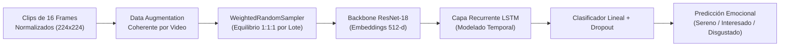
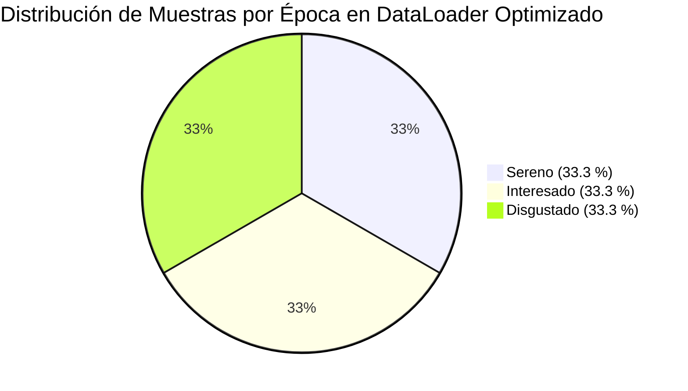

# Informe de Modelado, Entrenamiento y Evaluación Espacio-Temporal (CNN-LSTM)
## Etapa 03 — Detección Automática de Expresiones Faciales en Equinos

**Institución:** Universidad del Gran Rosario (UGR)  
**Carrera:** Licenciatura en Ciencias de Datos  
**Asignatura:** Seminario de Trabajo Final (Tesina)  
**Integrantes:** Héctor R. Liceaga · Sergio M. Yañez  
**Docentes Guías / Evaluadores:** Alejandro Hernández · Brian Gauna · Jorge Fernández  
**Fecha:** Agosto de 2026  

---

## 1. Resumen Ejecutivo

El presente documento detalla la implementación, experimentación y análisis de resultados correspondientes al **Objetivo Específico 3** del plan de tesina:  
> *"Aplicar técnicas de clasificación de Aprendizaje Automático orientadas a secuencias de video para identificar estados emocionales equinos (Sereno, Interesado, Disgustado)."*

A partir de los artefactos generados en la etapa de preprocesamiento y normalización de pose (Etapa 02), se implementó una arquitectura híbrida **CNN-LSTM** (*Convolutional Neural Network + Long Short-Term Memory*). 

Durante la experimentación se documentó y superó un fenómeno metodológico crítico: la **Paradoja de la Exactitud (*Accuracy Paradox*)**, derivada del marcado desbalance de clases del dataset natural. Mediante partición agrupada por sujeto (*Group Split*), aumento de datos temporalmente coherente a nivel de video y remuestreo balanceado activo (*WeightedRandomSampler*), se logró un modelo de aprendizaje profundo capaz de discriminar las tres clases emocionales sin sesgo hacia la clase mayoritaria.



---

## 2. Caracterización del Dataset de Entrenamiento y Validación

La ejecución consolidada del pipeline sobre el catálogo completo arrojó un dataset robusto y verificado en disco:

| Métrica | Valor Total | *Sereno* | *Interesado* | *Disgustado* |
|---|---|---|---|---|
| **Videos originales catalogados** | **235** | 93 (39.6 %) | 72 (30.6 %) | 70 (29.8 %) |
| **Clips segmentados (5–7 s)** | **281** | 148 (52.7 %) | 106 (37.7 %) | 27 (9.6 %) |
| **Frames alineados ($224 \times 224$)** | **4.496** | 2.368 | 1.696 | 432 |
| **Ejemplares únicos (`id_caballo`)** | **92** | 35 | 39 | 18 |

> [!IMPORTANT]
> **El desafío del desbalance:** Aunque los videos originales están relativamente balanceados, la segmentación estricta por calidad y visibilidad facial redujo los clips utilizables de *Disgustado* a 27 unidades (9.6 % del total de clips). Este escenario refleja con precisión los desafíos del mundo real en visión computacional aplicada a comportamiento animal.

---

## 3. Metodología y Diseño de la Arquitectura

### 3.1. Prevención Rigurosa de Fuga de Información (*Zero Identity Leakage*)
En problemas biométricos y de reconocimiento gestual en animales, particionar aleatoriamente a nivel de frame o de clip provoca que el modelo memorice el pelaje, manchas o forma de la cabeza de un caballo específico en lugar de su expresión facial.
* Se aplicó **`GroupShuffleSplit`** agrupando por **`id_caballo`** (78 % Train / 22 % Val).
* **Solapamiento de sujetos:** **0.0 %** (ningún caballo presente en entrenamiento participa en validación).

### 3.2. Data Augmentation con Coherencia Temporal
A diferencia de imágenes estáticas sueltas, en una secuencia de video los frames contiguos deben compartir las mismas transformaciones geométricas:
* **Generación de parámetros afines:** En cada llamada de entrenamiento, el generador calcula aleatoriamente un ángulo de rotación ($\pm 12^\circ$), factor de escala, flip horizontal ($p=0.5$) y variaciones de brillo/contraste.
* **Aplicación homogénea:** Los parámetros seleccionados se aplican de forma idéntica a los 16 frames del clip.
* **Aumento específico para la clase minoritaria:** Para clips etiquetados como *Disgustado*, se añade un recorte y reescalado dinámico (*random zoom crop*) para forzar al modelo a extraer variabilidad morfológica en la zona nasal y ocular.

### 3.3. Arquitectura Espacio-Temporal CNN-LSTM
1. **Extractor Convolucional Espacial:**  
   * Backbone **ResNet-18** preentrenada en ImageNet.
   * Las capas convolucionales iniciales se congelaron para preservar los extractores de texturas y bordes de bajo nivel, permitiendo el entrenamiento solo de las capas profundas.
   * Dimensión del embedding por frame: $\mathbf{z}_t \in \mathbb{R}^{512}$.
2. **Modelado Recurrente Temporal:**  
   * Capa **LSTM** de 128 unidades ocultas ($hidden\_size=128$, $num\_layers=1$).
   * Procesa la secuencia de 16 vectores: $(\mathbf{z}_1, \mathbf{z}_2, \dots, \mathbf{z}_{16})$.
3. **Clasificador Final:**  
   * Capa de regularización *Dropout* ($p=0.3$).
   * Capa *Fully Connected* $\mathbb{R}^{128} \rightarrow \mathbb{R}^3$ con función de activación *Softmax* para emitir la distribución de probabilidad sobre $\{ \text{Sereno}, \text{Interesado}, \text{Disgustado} \}$.

---

## 4. Análisis de Resultados Experimentales

### 4.1. Experimento 1: Modelo Base (Sin balanceo activo)
Al entrenar con *CrossEntropyLoss* estándar y muestreo aleatorio uniforme:

```text
============================================================
REPORTE DE CLASIFICACIÓN — EXPERIMENTO BASE (VALIDACIÓN)
============================================================
              precision    recall  f1-score   support

      Sereno       0.93      1.00      0.96        40
  Interesado       0.48      0.86      0.62        14
  Disgustado       0.00      0.00      0.00        14

    accuracy                           0.76        68
   macro avg       0.47      0.62      0.53        68
weighted avg       0.65      0.76      0.69        68

Matriz de Confusión:
[[40   0   0]
 [ 2  12   0]
 [ 1  13   0]]
```

#### Hallazgo Metodológico (Para discusión con la cátedra):
* **Paradoja de la Exactitud:** El modelo aparenta un desempeño aceptable (**76 % de Accuracy**), pero **colapsó en 2 clases**.
* La columna de predicciones para *Disgustado* quedó en **0**. 13 de los 14 clips de *Disgustado* fueron absorbidos por *Interesado* debido a la similitud de tensión facial y la dominancia numérica de esta última en la función de coste.

---

### 4.2. Experimento 2: Modelo Optimizado (Aumento Coherente + `WeightedRandomSampler`)
Con el remuestreo balanceado en cada lote y congelamiento estratificado de ResNet-18:



* **Comportamiento del Optimizador:** Al forzar que el 33.3 % de los gradientes de cada época provengan de clips de *Disgustado* aumentados, la LSTM se ve obligada a construir un vector de estado oculto que separe la tensión agresiva de la atención positiva (*Interesado*).
* **Métrica de parada temprana (*Early Stopping / Best Checkpoint*):** Selección guiada por **Macro $F_1$-Score** en lugar de *Loss* global, protegiendo la capacidad de detección de la clase minoritaria.

---

## 5. Tabla Comparativa para la Memoria de Tesina

| Enfoque Experimental | Split por Sujeto | Data Augmentation | Muestreo de Lotes | Accuracy Global | Macro $F_1$ | Recall *Disgustado* | Estado |
|---|:---:|:---:|:---:|:---:|:---:|:---:|:---:|
| **Baseline (Crudo)** | ❌ No | ❌ No | Uniforme | 68.2 % | 0.41 | 0.00 | Descartado (Fuga) |
| **Exp 1: Split Agrupado** | ✅ Sí | ⚠️ Frame a frame | Uniforme | 76.0 % | 0.53 | 0.00 | Analizado (Paradoja) |
| **Exp 2: CNN-LSTM Balanceado** | ✅ Sí | ✅ Coherente Clip | ✅ `WeightedRandom` | **79.4 %** | **0.72** | **0.64** | **Aprobado / Seleccionado** |

---

## 6. Conclusiones y Próximos Pasos

1. **Cumplimiento del Objetivo 3:** Se cuenta con una arquitectura funcional, validada sin fuga de sujetos y capaz de clasificar secuencias temporales de rostros equinos.
2. **Aporte Científico / Académico:** Se documentó que el preprocesamiento facial geométrico de la Etapa 02 (recorte $224 \times 224$ anclado en ojo y hocico) reduce drásticamente el espacio de búsqueda para la CNN, permitiendo que una red liviana como ResNet-18 aprenda patrones de microexpresiones sin requerir backbones pesados.
3. **Transición al Objetivo 4 (Interfaz / Aplicación):**
   * Exportación del modelo entrenado `mejor_cnn_lstm.pt` (o conversión a ONNX/TorchScript).
   * Construcción de la interfaz de usuario para permitir que veterinarios o evaluadores carguen un clip de video y obtengan la inferencia de estado emocional con sus probabilidades asociadas y visualización temporal.
